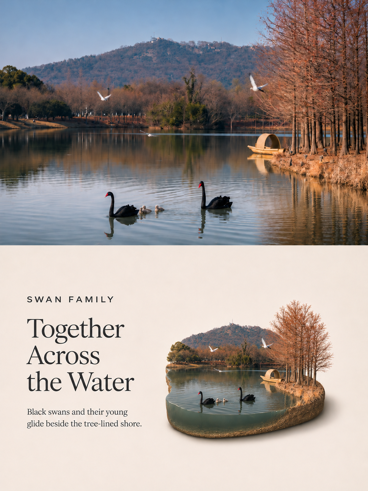

# Photo Poster Skills

一个汇集多种照片海报效果的 Codex 技能集合。每种效果拥有独立目录、使用说明、示例与版本；按需安装其中一种即可。

## 海报效果

### Photo to Isometric Diorama Poster · 照片 × 等距微缩海报

将照片转化为 3:4 上下分区海报：上方摄影画面，下方为保留真实材质的等距微缩场景，默认采用左侧英文文案、右侧模型的编辑式布局。

[](posters/photo-to-isometric-diorama-poster/README.md)

**版本：v1.8** · [详细说明与更多示例](posters/photo-to-isometric-diorama-poster/README.md) · [v1.8 Release](https://github.com/zhuchenyang/Photo-Poster-Skills/releases/tag/isometric-diorama-v1.8)

## 目录结构

```text
README.md
RELEASING.md
scripts/package_poster.py
posters/
└── photo-to-isometric-diorama-poster/
    ├── README.md
    ├── SKILL.md
    ├── agents/
    ├── references/
    └── assets/examples/
```

新增效果时，在 `posters/` 下建立独立目录，并在本页加入简述、一张参考图及详细 README 链接。不要把新效果的文件混入现有技能目录。

## 安装与使用

优先从对应效果的 Release 下载独立安装 ZIP，将其中的技能目录解压到 Codex 的 `skills` 目录。也可以下载仓库源码，仅复制需要的 `posters/<技能名>/` 子目录。不要将整个集合仓库直接作为一个技能安装。

每个效果的依赖、调用方式和示例请阅读其 README。已有同名技能时先备份再更新。

## 独立版本与发布

本集合不设统一版本。各效果分别维护版本，后续标签采用效果前缀，例如 `isometric-diorama-v1.4.0`，并附上只包含对应效果的安装 ZIP。GitHub 自动生成的 Source code 包包含整个仓库，不等同于单效果安装包。

现有 `v1.3` 标签与 Release 保持不变，仍对应重组前的历史快照。发布步骤见 [RELEASING.md](RELEASING.md)。

Latest 标记始终指向最新发布的正式 Release，不区分海报效果，也不跨效果比较版本号；每种效果仍独立维护版本与安装包。
