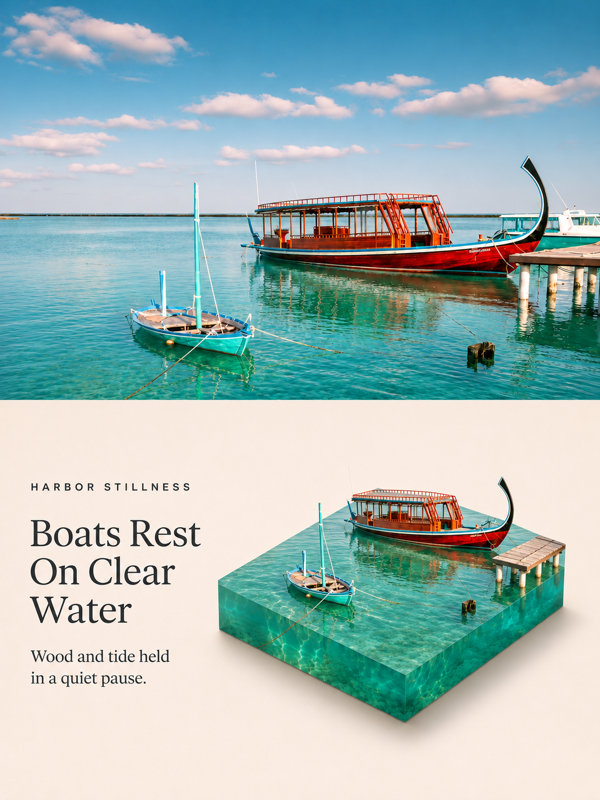
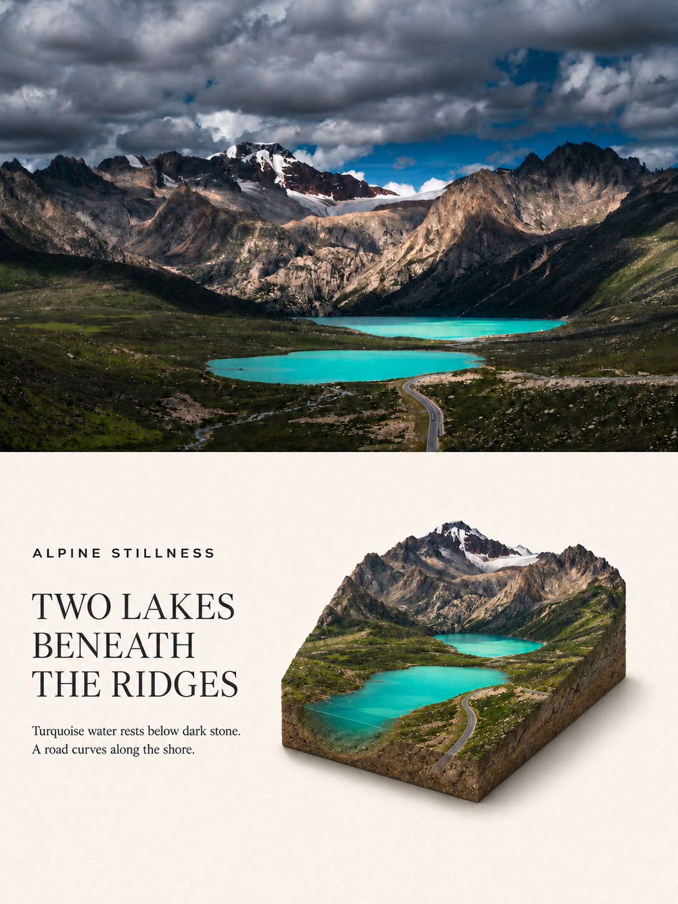
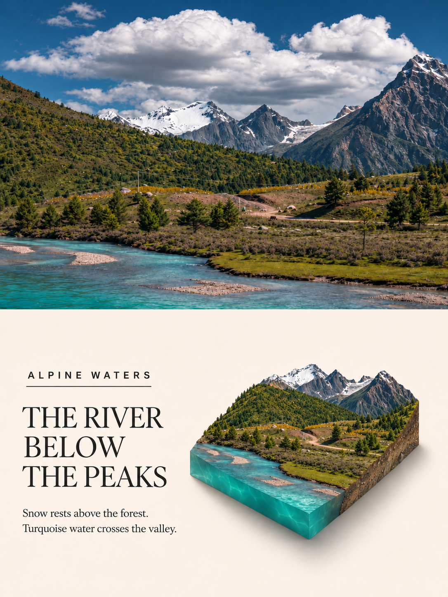

# Photo to Isometric Diorama Poster

将照片转化为上方摄影画面、下方等距微缩场景的精致海报，默认配有英文编辑式文案。

当前版本：**v1.8**。

## 效果示例

### 最新示例 · Swan Family（v1.8）

[](assets/examples/swan-family.png)

采用用户选定的最新海报，展示前景水体的水下体积、自然接触阴影，以及左文右景的宽松留白。上方摄影画面经生成式重构；模型水深为艺术推断，不代表实测。

### 更多场景参考

以下三张展示同一套版式在不同场景中的表现：上半部摄影画面，下半部英文文案与微缩模型。点击图片可查看原图。

| 港湾 · Harbor Stillness | 双湖 · Alpine Stillness | 河谷 · Alpine Waters |
| --- | --- | --- |
| [](assets/examples/harbor-stillness.png) | [](assets/examples/alpine-stillness.png) | [](assets/examples/alpine-waters.jpg) |

## 视觉规则

- 竖版 3:4，上下各占 50%。
- 下半部默认采用暖中性背景，左侧英文文案、右侧完整微缩模型。
- 文案包括眉题、主标题与两行辅助文字，随照片内容变化，保持简洁、克制的编辑风格，情绪与画面内容相符。
- 先预留文字空间，再确定模型位置，必要时整体等比缩小；完整轮廓和阴影均需保留宽松留白。
- 保留主体身份、比例、空间关系、实际材质及其边界；体积和支撑结构从原图推导，不强制所有主体使用地形底座。
- 前景水体应在基座或外露侧面呈现水面以下的可读深度，保持原图水色、清澈度、浑浊感和水陆连续关系。
- 保留原图已有的围边、框架和支撑；禁止凭空增加装饰性结构。
- 用户可要求无字版本、其他语言或指定文案。

## 安装到 Codex

本效果是 [海报技能集合](../../README.md) 中的一个独立技能。

[下载 v1.8 独立安装包](https://github.com/zhuchenyang/Photo-Poster-Skills/releases/download/isometric-diorama-v1.8/photo-to-isometric-diorama-poster-v1.8.zip)。

优先下载对应 Release 附带的 `photo-to-isometric-diorama-poster-v<版本>.zip`，解压后将 `photo-to-isometric-diorama-poster` 文件夹放入 Codex 用户技能目录（通常为 `~/.codex/skills/`；设置 `CODEX_HOME` 时使用其 `skills` 子目录）。

也可下载集合仓库源码，只复制 `posters/photo-to-isometric-diorama-poster/`。不要把整个仓库克隆到单个技能目录。已有同名技能时先备份再更新。

当前 [历史 v1.3 Release](https://github.com/zhuchenyang/Photo-Poster-Skills/releases/tag/v1.3) 保留原有布局，可使用其 Source code (zip)，将解压根目录命名为技能名后安装；后续发布优先使用单效果安装 ZIP。

```text
photo-to-isometric-diorama-poster/
├── SKILL.md
├── references/prompt-template.md
├── references/version-history.md
└── agents/openai.yaml
```

## 使用

附上照片并请求：

```text
使用 $photo-to-isometric-diorama-poster 处理这张照片。
```

也可以指定“不要文字”“改用中文文案”或自定义标题。

## 工具依赖与保真说明

本仓库提供技能指令和提示模板，不包含图像模型或可执行生成器。实际生成需要支持参考图片的图像生成或编辑工具，优先使用 Codex 可用的内置工具。

生成式处理可能改变上半部照片细节；若要求原片像素保真，需要单独生成下半部，再通过可用的图像合成工具拼接原照。未见的表面、内部结构及水体深度属于合理艺术重构，并非测量或事实复原。

CLI/API 备用方式仅在用户明确选择时使用，可能需要本地配置 API 密钥、依赖和网络，并产生 API 费用。不要将密钥提交到仓库。

## 独立发布

本效果独立维护版本。标签使用 `isometric-diorama-v<版本>`；本次为 `isometric-diorama-v1.8`，Release 标题为 `Isometric Diorama Poster v1.8`。发布时附上单效果安装 ZIP，具体步骤见 [发布指南](../../RELEASING.md)。

## v1.8：通用重建原则与前景水体深度

- 统一根据可见主体、空间关系、材料属性和连接关系重建，不为不同场景维护专用处理流程。
- 通过体积、比例适当的厚度、可读侧面和自然阴影表现三维感，不再强制所有照片生成厚地形切片。
- 前景出现水体时，基座或外露侧面必须呈现可感知的水柱深度；不能只在不透明土石板上绘制水面。保持原图水色和光学特性，并与合理的水下基底及岸坡连续衔接。
- 不强制透明蓝色树脂或独立纯水块；不新增无依据的围边和装饰支撑，原图已有结构应保留。
- 保留真正的单材质、单色外观，文案情绪随可见内容变化；正文、提示词模板和验收标准同步。
- 保留 3:4、上下等分、默认英文左文右景、30°–45°俯视、四边留白和接触阴影。首轮确定完整模型及阴影占位，必要时整体等比缩小。
- 历史决策已移入 references/version-history.md，仅供维护查阅，不参与日常生成。

旧示例作为不同场景的视觉参考保留，不代表均通过 v1.8 的全部要求。每次成品仍需检查实际尺寸、分割位置、文字、材料及留白；严格原片保真需使用可用合成工具。
