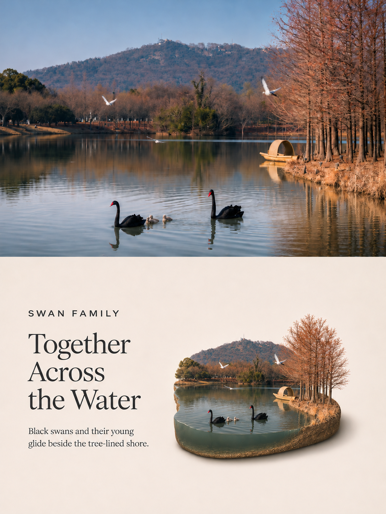
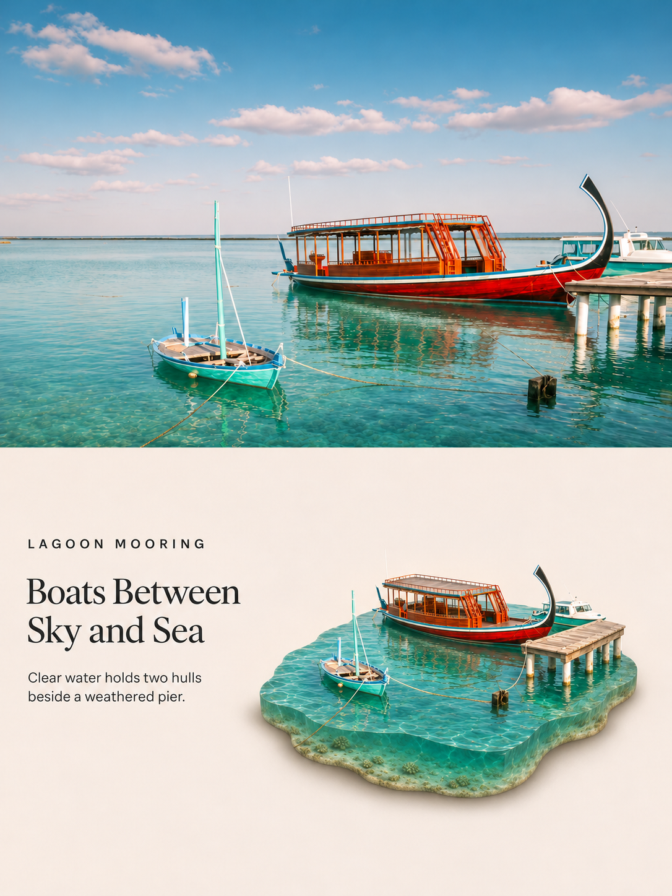
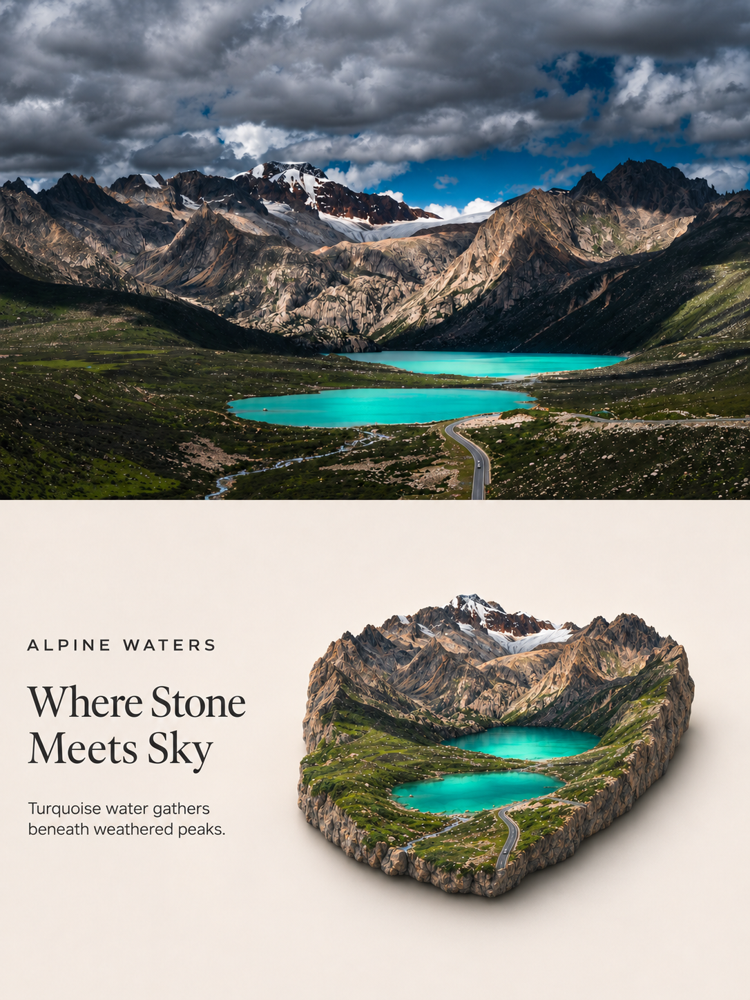
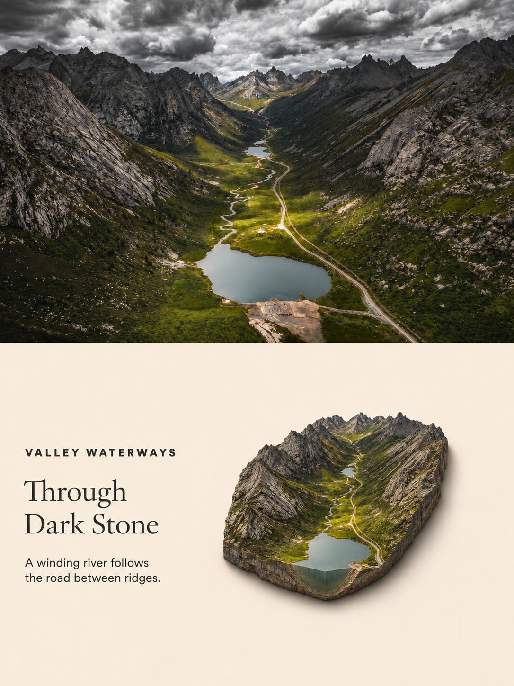

# Photo to Isometric Diorama Poster

将照片制作成 **3:4 上下分栏海报**：上方呈现摄影画面，下方以等距微缩形式重建同一主体，默认配有左侧英文编辑文案。

当前技能版本：**v1.9.0** · [Release](https://github.com/zhuchenyang/Photo-Poster-Skills/releases/tag/isometric-diorama-v1.9.0) · [下载独立安装包](https://github.com/zhuchenyang/Photo-Poster-Skills/releases/download/isometric-diorama-v1.9.0/photo-to-isometric-diorama-poster-v1.9.0.zip) · [技能正文](SKILL.md)

## 最新效果示例

[](assets/examples/swan-family.png)

**Swan Family · v1.8**。前景湖水在模型外露侧面呈现水面以下的体积，并与岸边地层连续衔接；完整模型与阴影保持宽松留白。上方摄影画面经生成式重构，模型水深属于艺术推断。

## 根据照片重建，使用统一原则

技能先观察实际照片，再识别主体特征、比例、姿态或配置、空间关系、材质及连接方式，据此确定微缩重建方式。构图与材质规则不预设照片必须包含建筑、地形、植被或水域，也不要求为每类场景另写处理流程。

主体应保持可辨识，模型应有真实的三维体积。承载面、侧面、厚度或剖切方式由照片中的结构决定；仅补全俯视重建所必需的不可见部分。具体效果仍受照片信息和生成工具能力影响。

### 材质与结构

- 优先级：**真实材质身份 > 空间结构准确性 > 雕塑表现 > 风格统一**。
- 保留实际材质的颜色、纹理、透明度、反射特征和边界；缩小细节时保持材质类别。
- 保持物体之间的连接、承托和连续结构，不为展示剖面而拆开本应连贯的部分。
- 原图本就是单材质或单色时，保留这种外观，包括真实存在的石膏、树脂等材质。
- 保留照片中已有的围边、框架和支撑，不凭空增加装饰性边框、托盘或底座。
- 不强制所有主体使用厚地形切片；以适当的体积、侧面、厚度、遮挡和光影体现立体感。

### 前景水体的深度

**当前景出现水体时，基座或外露侧面必须体现水面以下可感知的水柱深度。**

保持照片中的水色、清澈度和浑浊感，通过侧面体积、自然色调衰减等表现深度；浑浊的水也应有可读深度，无需强制透明。水体与岸坡、合理水下基底保持连续，避免仅把水面绘在不透明土石板上。

不默认替换为透明蓝色树脂，不强制孤立的纯水块，也不新增围边。模型水深及不可见结构属于合理艺术重建，不代表实测。

## 海报构图

| 项目 | 默认要求 |
| --- | --- |
| 画幅 | 竖版，宽高比严格为 3:4 |
| 上下分区 | 摄影与微缩场景各占画布高度的 50% |
| 上半部 | 保持摄影外观，保留主体及已确定裁切中的内容，不拉伸或挤压 |
| 下半部 | 左侧文案、右侧完整模型，暖中性背景与柔和棚拍光 |
| 视角 | 30°–45°俯视的等距风格 |
| 留白 | 完整轮廓及可见阴影均与文字、分割线、四周边缘保持距离 |
| 阴影 | 根据实际接触和几何关系形成自然接触阴影，近处较深、远处渐软 |

首轮生成前先预留文字列，再确定完整模型及阴影的占位。有字版本的起始上限约为下半区宽度的 **48%–52%**、高度的 **58%–64%**；按更严格的方向等比缩小，可以更小，不要求填满。

无字版本以整体视觉重心居中，起始上限约为下半区宽度的 **65%–70%**、高度的 **70%–75%**。这些数值是构图指导，最终还需检查完整轮廓和实际四边留白。

若上半区的已选裁切无法填满分区，仅沿缺失边界扩展与原画面一致的内容，保持透视、尺度、光线和纹理，不以重复纹理或新增焦点填充。

## 默认英文文案

- 眉题：2–3 个英文单词，全大写、小号无衬线字体。
- 主标题：3–6 个英文单词，分成 2–3 行，常规字重衬线字体。
- 辅助文字：两短行，合计约 8–14 个英文单词。

文案围绕照片中可见的主体或场景特征，保持简洁、克制的编辑风格；具体情绪和力度随画面变化。避免套用固定场景与情绪配对、泛用口号，以及虚构地名、历史、季节或个人故事。最终文字和预期换行会明确写入生成请求，并检查拼写与可读性。

## 安装

本效果是 [Photo Poster Skills 集合](../../README.md) 中的独立技能。

1. 下载 [v1.9.0 独立安装 ZIP](https://github.com/zhuchenyang/Photo-Poster-Skills/releases/download/isometric-diorama-v1.9.0/photo-to-isometric-diorama-poster-v1.9.0.zip)。
2. 解压，将其中的 `photo-to-isometric-diorama-poster` 文件夹放入 Codex 用户技能目录，通常为 `~/.codex/skills/`；设置了 `CODEX_HOME` 时使用其 `skills` 子目录。
3. 更新已有同名技能前先备份旧版本。

也可从仓库源码中复制 `posters/photo-to-isometric-diorama-poster/`。GitHub 自动生成的 Source code 包包含整个集合，请只安装所需效果目录。

主要文件：

```text
photo-to-isometric-diorama-poster/
├── SKILL.md
├── README.md
├── agents/openai.yaml
├── references/
│   ├── prompt-template.md
│   └── version-history.md
└── assets/examples/
```

## 使用

附上可访问的照片并请求：

```text
使用 $photo-to-isometric-diorama-poster 处理这张照片。
```

可补充“不要文字”“改用中文文案”、指定标题，或明确要求保留原片像素。无字版本会移除文案并改用居中布局；其他语言、指定文案或材质风格按用户要求处理。

## 工具与保真

本技能提供指令及提示模板，不自带图像模型或可执行生成器。生成需要支持参考图片的图像生成或编辑工具，优先使用可用的内置工具；内置工具可用时不要求用户提供 API 密钥。

单次生成式处理可能改变上半部照片细节，不能保证原片逐像素保真。严格保真需要单独生成下半部，再使用当前图像工作流允许的合成工具放入未经修改的原片裁切及必要的边界扩展；缺少该工具时需说明限制。

CLI/API 备用方式仅在用户明确选择后使用，需要本地配置密钥、依赖和网络，并可能产生 API 费用。不要在聊天中提供密钥或将其提交到仓库。

交付前应查看成品并测量实际尺寸与分割位置，检查主体对应、材质、前景深度、阴影、文字及留白；没有查看或测量的结果不能宣称已核验。

## 历史视觉参考

以下为较早版本的场景示例，供比较构图与材质表现，不代表均满足 v1.8 的全部要求。点击图片可查看大图。

| 港湾 · Lagoon Mooring | 双湖 · Where Stone Meets Sky | 河谷 · Alpine Waters |
| --- | --- | --- |
| [](assets/examples/lagoon-mooring.png) | [](assets/examples/where-stone-meets-sky.png) | [](assets/examples/alpine-waters-v1.9.0.png) |

## 版本与维护

v1.9.0 在 v1.8 的基础上补充了左侧三段文字的固定排版规范：统一左对齐轴、整体垂直居中、字体类别、字号比例、行高和段间距；同时更新河谷示例图。前景水体深度、宽松留白和自然接触阴影要求保持不变。

[提示词模板](references/prompt-template.md)用于准备生成请求；[版本历史](references/version-history.md)仅用于查阅历史决策，不参与日常生成。

本效果独立维护版本，标签为 `isometric-diorama-v<版本>`。当前 [v1.9.0 Release](https://github.com/zhuchenyang/Photo-Poster-Skills/releases/tag/isometric-diorama-v1.9.0) 附带单效果安装包。维护者发布流程见 [RELEASING.md](../../RELEASING.md)。
