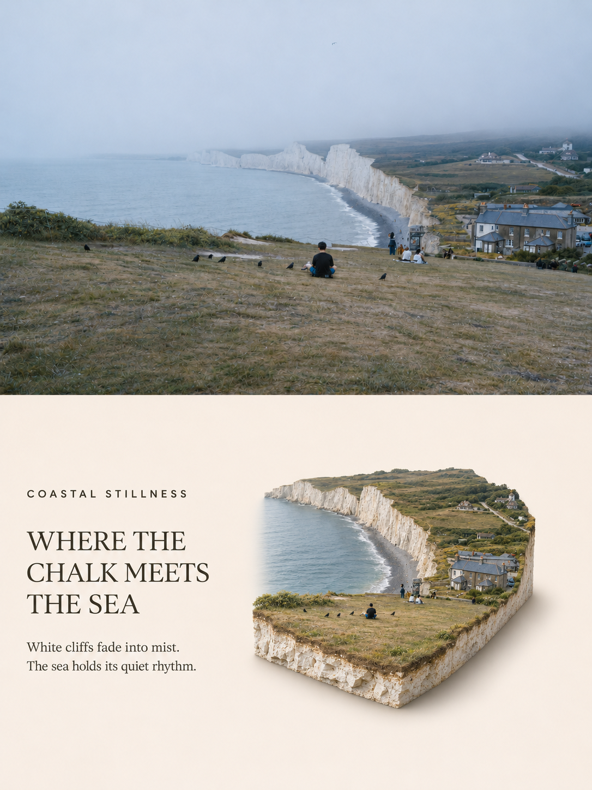
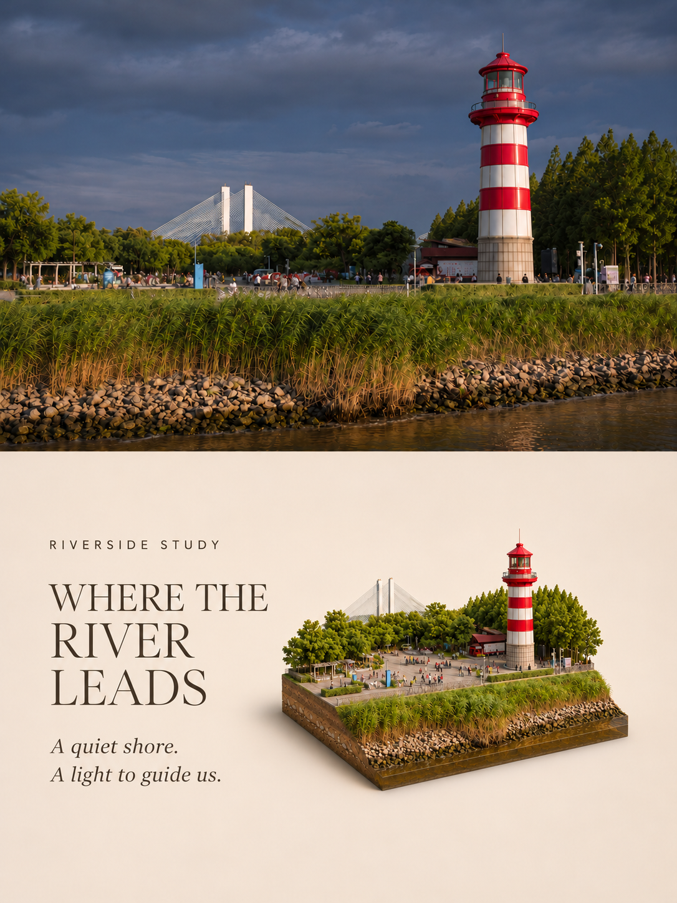
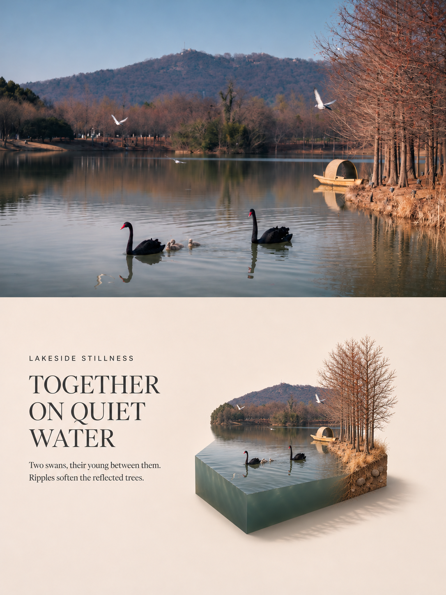

# Photo to Isometric Diorama Poster

将照片转化为上方摄影画面、下方等距微缩场景的精致海报，默认配有英文编辑式文案。

当前版本：**v1.4**。

## 效果示例

以下三张展示同一套版式在不同场景中的表现：上半部摄影画面，下半部英文文案与微缩模型。点击图片可查看原图。

| 海崖 · Coastal Stillness | 灯塔 · Riverside Study | 湖畔 · Lakeside Stillness |
| --- | --- | --- |
| [](assets/examples/coastal-stillness.png) | [](assets/examples/riverside-study.png) | [](assets/examples/lakeside-stillness.png) |

## 视觉规则

- 竖版 3:4，上下各占 50%。
- 下半部默认采用暖中性背景，左侧英文文案、右侧完整微缩模型。
- 文案包括眉题、主标题与两行辅助文字，随照片内容变化，保持安静、克制的语气。
- 先预留文字空间，再确定模型位置，必要时整体等比缩小；完整轮廓和阴影均需保留宽松留白。
- 保留土壤、岩石、植被、木材、砖石、混凝土等真实材质，剖面与场景地形相符。
- 用户可要求无字版本、其他语言或指定文案。

## 安装到 Codex

本效果是 [海报技能集合](../../README.md) 中的一个独立技能。

优先下载对应 Release 附带的 `photo-to-isometric-diorama-poster-v<版本>.zip`，解压后将 `photo-to-isometric-diorama-poster` 文件夹放入 Codex 用户技能目录（通常为 `~/.codex/skills/`；设置 `CODEX_HOME` 时使用其 `skills` 子目录）。

也可下载集合仓库源码，只复制 `posters/photo-to-isometric-diorama-poster/`。不要把整个仓库克隆到单个技能目录。已有同名技能时先备份再更新。

当前 [历史 v1.3 Release](https://github.com/zhuchenyang/Photo-Poster-Skills/releases/tag/v1.3) 保留原有布局，可使用其 Source code (zip)，将解压根目录命名为技能名后安装；后续发布优先使用单效果安装 ZIP。

```text
photo-to-isometric-diorama-poster/
├── SKILL.md
├── references/prompt-template.md
└── agents/openai.yaml
```

## 使用

附上照片并请求：

```text
使用 $photo-to-isometric-diorama-poster 处理这张照片。
```

也可以指定“不要文字”“改用中文文案”或自定义标题。

## 工具依赖与保真说明

本仓库提供技能指令和提示模板，不包含图像模型或可执行生成器。实际生成需要支持参考图片的图像生成或编辑工具，优先使用 Codex 可用的内置工具。

生成式处理可能改变上半部照片细节；若要求原片像素保真，需要单独生成下半部，再通过可用的图像合成工具拼接原照。未见的地下层次属于合理艺术重构。

CLI/API 备用方式仅在用户明确选择时使用，可能需要本地配置 API 密钥、依赖和网络，并产生 API 费用。不要将密钥提交到仓库。

## 独立发布

本效果独立维护版本。后续标签使用 `isometric-diorama-v<版本>`，例如 `isometric-diorama-v1.4.0`；Release 标题为 `Isometric Diorama Poster v1.4.0`。发布时附上单效果安装 ZIP，具体步骤见 [发布指南](../../RELEASING.md)。当前技能版本为 v1.4。

## v1.4：水体截面规则

水面下方的模型体积与外露侧面默认表现为水体，不再默认展示河床、湖床或海床土石剖面。保持原照水色、透明度与浑浊程度，不添加土石托底或围边。混合场景按区域区分：陆地展示土石或结构剖面，水域展示水体截面，并在岸线自然衔接。原照清楚可见水底或用户明确要求时，可展示相应水底细节。

上方三张示例制作于 v1.3，用于展示整体版式；其中水体基座尚未按 v1.4 新规则重新生成。
